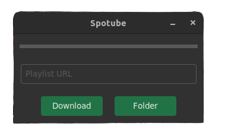
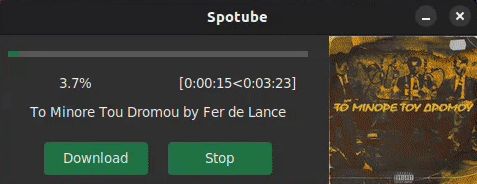

# Spotube

Spotube is a desktop app that downloads local `.mp3` copies of Spotify playlists, with cover art, artist and album information, and optionally lyrics. It is built on the [spotube](https://pypi.org/project/spotube/) package.

\
_The initial state of the UI_

## Download (Windows)

Download `Spotube-<version>-windows.zip` from the [Releases](https://github.com/GiorgosNik/spotube-desktop/releases) page, extract it, and run `Spotube.exe`. ffmpeg is included and no API keys are needed.

Songs are saved to `Music\Spotube` in your user folder unless you pick another folder.

## How it works

You paste the link to a public Spotify playlist. For each song, Spotube:

- Reads the song details from Spotify's public playlist view: name, artists, album, release year and cover art.
- Finds the best matching video on YouTube, preferring the one closest in length to the original.
- Downloads it in the best available quality and converts it to `.mp3`.
- Adds lyrics from Genius, if you provide a Genius token.
- Writes the tags and cover art into the file, named `Artist - Title.mp3`.
- Optionally evens out the volume across all songs.

## Using the app

1. Paste the playlist link into the `Playlist URL` field.
2. Optionally click `Select Folder` to choose where songs are saved.
3. Leave `Normalize Sound` ticked to even out volume levels, or untick it to skip that step.
4. Click `Download`.

The app shows the cover art and title of the current song, the elapsed time and the estimated time left. Click `Stop` to cancel; songs that already finished are kept.

\
_Dynamic UI updates_

### Playlists over 100 tracks

Without Spotify API keys, Spotify's public view only lists the first 100 tracks. To download longer playlists:

1. Click `Sign in to Spotify (100+ tracks)` once. A browser window opens; sign in and allow Exportify read access.
2. Make sure the playlist is in your Spotify library (created or followed by you).

The sign-in is remembered, so later downloads work in the background. It uses Microsoft Edge or Google Chrome.

### Optional API keys

Copy `.vars.example` to `.vars` (next to `Spotube.exe`, or in the project folder when running from source) and fill in what you have:

| Key | Effect |
|---|---|
| `GENIUS_TOKEN` | Adds lyrics. Free from the [Genius API](https://docs.genius.com/) |
| `SPOTIFY_ID`, `SPOTIFY_SECRET` | Reads playlists through the official Spotify API. Spotify requires the app owner to have Premium; without it, Spotube falls back to the public view automatically |

The standard names `GENIUS_ACCESS_TOKEN`, `SPOTIPY_CLIENT_ID` and `SPOTIPY_CLIENT_SECRET` work too, as environment variables.

## Running from source

Requires Python 3.12 or newer and ffmpeg on your PATH (`winget install ffmpeg`, `brew install ffmpeg` or `sudo apt install ffmpeg`).

```
python -m venv .venv
.venv\Scripts\activate
pip install -r requirements.txt
python spotube_ui.py
```

To check that everything is installed correctly without opening the window, run `python spotube_ui.py --self-test`.

For a command-line downloader, use the package directly: `pip install spotube[exportify]`, then `spotube download <playlist link>`.

## Development

```
pip install -r requirements-dev.txt
pre-commit install
pytest
```

`pre-commit install` adds a git hook that runs ruff and blocks commits containing secrets.

Pushing a version tag (for example `v1.0.0`) builds the Windows app, checks it with `--self-test` and publishes it as a GitHub release.

## Disclaimer

Spotube is aimed strictly at personal use, as per the YouTube, Spotify and LyricsGenius license agreements. Sharing the
content collected by using this application, or using it for profit is strictly prohibited.
